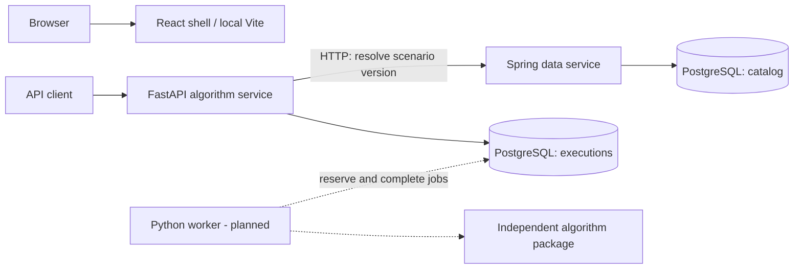
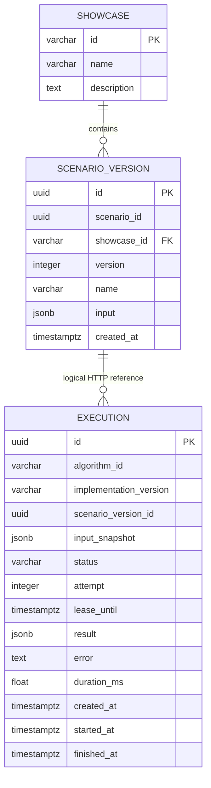

# Algorithm Lab Architecture

Status: implemented architecture as of November 1, 2026, with planned components explicitly identified.

This document describes component responsibilities, data ownership, interfaces, and execution semantics. See [Local Development](development.md) for installation, startup, builds, tests, and migration commands. The [first vertical slice plan](Algorithm_Lab_First_Vertical_Slice_Plan.md) defines the delivery goal; the [extended project plan](Algorithm_Lab_Project_Plan_Extended_Tech_Stack.md) describes the broader target architecture.

## 1. Purpose and Current Scope

Algorithm Lab connects independent algorithm implementations with an interactive web application and reproducible data experiments. The first vertical slice uses iterative Fibonacci to establish the path from a versioned scenario to a durable execution and, eventually, a displayed result.

| Component or capability | Current state |
| --- | --- |
| React application | Application shell, MUI theme, router and TanStack Query providers; no backend calls or execution views yet |
| Spring data service | Read-only catalog and immutable scenario-version APIs; Flyway migrations and health endpoints |
| Python algorithm package | Iterative Fibonacci implementation with reference and property tests |
| FastAPI algorithm service | Create and read executions; Spring scenario lookup, validation, persistence, and resource lifecycle |
| Execution reservation | Repository method with expiring leases, attempt tracking, and concurrent reservation protection |
| Worker | Planned: computation, guarded completion, failure handling, and a processing loop |
| Web server / reverse proxy | Planned: serve the static frontend and route requests to both APIs |
| Additional data stores / outbox | Planned in later slices; not dependencies of this slice |

The current API can persist a job as `queued`. Reservation code can transition it to `running`, but there is no running worker that invokes it or stores computed results. The complete browser workflow is not yet available.

## 2. Component Boundaries



The browser-to-backend connections are not drawn as implemented paths: the current React application does not issue API requests. Both database schemas reside in one local PostgreSQL instance.

### React frontend

Source: [apps/web](../apps/web).

React and TypeScript define the interface; Vite provides local development and static production builds. MUI supplies the theme, baseline styles, and components. `BrowserRouter` and `QueryClientProvider` are configured, while showcase routes, server queries, mutations, and polling remain to be added.

React Hook Form, Zod, `openapi-fetch`, and `openapi-typescript` are installed for future form validation and typed API access. Backend client generation is not wired into the build yet. The current Vite configuration has no API proxy.

### Spring data service

Source: [catalog package](../apps/data-service/src/main/kotlin/de/eseidinger/algorithmlab/dataservice/catalog).

Spring owns the showcase catalog and scenario versions. `CatalogController` handles HTTP and delegates read queries to `CatalogRepository`. The repository uses explicit SQL through `JdbcClient` and maps PostgreSQL JSONB input to a Jackson `JsonNode`, preserving an object in the HTTP response.

There is no separate application-service layer for these straightforward reads. It can be introduced when domain operations require orchestration or transactions spanning multiple repository calls.

Spring does not calculate Fibonacci and does not read or write Python execution tables.

### Python algorithm service

Source: [algorithm_service](../apps/algorithm-service/src/algorithm_service).

| Module | Responsibility |
| --- | --- |
| `main.py` | Compose resources and services using FastAPI lifespan |
| `api.py` | POST/GET routes, dependency lookup, HTTP status and error translation |
| `schemas.py` | Public request/response models, Spring response model, and Fibonacci input validation |
| `data_client.py` | Synchronous HTTPX calls to Spring and upstream response validation |
| `executions.py` | Resolve and validate scenarios, choose the algorithm/version, and coordinate persistence |
| `models.py` | Internal typed execution record and allowed statuses |
| `repository.py` | SQLAlchemy SQL for creation, lookup, and job reservation |
| `config.py` | Environment-based settings and the psycopg database URL |

FastAPI routes are synchronous because the HTTPX and SQLAlchemy operations are synchronous. The asynchronous lifespan manages startup and shutdown; it does not make database operations asynchronous.

### Independent algorithm package

Source: [packages/algorithms](../packages/algorithms).

`algorithm_lab.fibonacci.fibonacci` implements the numerical calculation without HTTP or persistence dependencies. The service depends on this package through the uv workspace. The future worker will invoke the algorithm; creating or reading an execution does not currently invoke it.

The algorithm uses `F(0) = 0`, `F(1) = 1` and rejects negative inputs. The HTTP-facing workflow additionally restricts input to strict integers from 0 through 78, keeping results within JavaScript's safe integer range.

## 3. Data Ownership and Schema

One local database, `algorithm_lab`, has two application-owned schemas:

| Owner | Schema and tables | Role | Migration tool |
| --- | --- | --- | --- |
| Spring | `catalog.showcase`, `catalog.scenario_version` | `catalog_app` | Flyway |
| Python | `executions.execution` | `execution_app` | Alembic |

The [initialization script](../infra/postgres/001-init.sql) creates the roles and schemas. Separate schemas, ownership, and credentials express the service boundary; the shared PostgreSQL instance remains a shared operational dependency. Applications access the other service's domain through HTTP, not cross-schema queries.



The relationship from execution to scenario version is logical: there is no database foreign key across service boundaries. The service validates the referenced version through Spring before inserting the job.

### Scenario identity and immutability

`scenario_id` identifies a scenario across versions; `id` identifies one immutable version. The pair `(scenario_id, version)` is unique. A PostgreSQL trigger rejects row updates and deletes of scenario versions. Changed inputs require a new row with a new version identity.

The initial fixture is showcase `K01`, scenario version `00000000-0000-4000-8000-000000000010`, with input `{"n": 10}`.

### Execution identity and reproducibility

An execution has its own UUID and records the scenario-version reference, validated input snapshot, algorithm identifier, and implementation version. The service currently chooses `fibonacci.iterative` and version `1`; the client cannot override these or supply different inputs.

The input snapshot allows execution reads and future computation without another Spring lookup. Algorithm behavior changes require maintaining a meaningful implementation version; the current version is an explicit code constant, not an automatically generated artifact digest.

## 4. HTTP Contracts

### Spring: `/api/data`

| Method and path | Successful response | Relevant failures |
| --- | --- | --- |
| `GET /showcases` | `200`, ordered list of showcase objects | Unexpected storage failures |
| `GET /scenario-versions/{id}` | `200`, version metadata and structured input | `404` unknown UUID; `400` malformed UUID |

Spring also exposes Actuator health and readiness endpoints. There are no scenario creation or update endpoints yet.

### FastAPI: `/api/algorithms`

| Method and path | Successful response | Relevant failures |
| --- | --- | --- |
| `POST /executions` | `201`, execution representation and relative `Location` | `422` invalid request or unsupported inputs; `404` unknown scenario; `503` upstream unavailable; `502` invalid upstream response |
| `GET /executions/{execution_id}` | `200`, persisted execution representation | `404` unknown execution; `422` malformed UUID |

POST accepts a scenario reference:

```json
{
  "scenarioVersionId": "00000000-0000-4000-8000-000000000010"
}
```

Request models reject extra fields. Their alias configuration also accepts Python-style field names; responses are serialized with camelCase names.

`ExecutionResponse` explicitly maps the internal `input_snapshot` to public `input`. It exposes identity, algorithm/version, status, input, result, and creation/start/finish/duration fields. Internal attempt, lease, and error fields are not included.

Each successful POST creates a distinct execution; no idempotency key or request deduplication is implemented. Unexpected internal errors remain server errors rather than being converted to success. FastAPI publishes `/docs` and `/openapi.json`; Spring OpenAPI generation is not configured yet.

## 5. Create and Read Flow

```mermaid
sequenceDiagram
    participant C as API client
    participant A as FastAPI
    participant S as Spring
    participant D as PostgreSQL
    C->>A: POST execution with scenario version ID
    A->>S: GET scenario version
    S->>D: Read catalog.scenario_version
    D-->>S: Immutable inputs and metadata
    S-->>A: Scenario JSON
    A->>A: Validate response identity, showcase and n
    A->>D: Begin transaction; insert queued job
    D-->>A: Stored row and generated defaults
    A->>D: Commit
    A-->>C: 201 + Location + execution
    C->>A: GET Location
    A->>D: Read executions.execution
    D-->>A: Persisted job
    A-->>C: 200 + execution
```

No database transaction is held open while calling Spring. The HTTP client validates response structure and ensures the returned version ID matches the requested ID. The execution service accepts only `K01` and validates `n` without coercing strings, booleans, or floats to integers.

The repository uses a typed JSONB parameter for the input snapshot and PostgreSQL `RETURNING` for database defaults. It validates the returned internal model inside the transaction and returns only after successful commit.

If scenario resolution or validation fails, no job is inserted. GET reads PostgreSQL only; it does not contact Spring. A committed execution survives API process restarts.

## 6. Reservation and Future Worker Semantics

Implemented reservation behavior in `ExecutionRepository.reserve_execution()`:

1. Select a queued job or a running job with an expired, non-null lease.
2. Order candidates by creation time and UUID.
3. Lock at most one candidate with `FOR UPDATE SKIP LOCKED`.
4. Atomically set `running`, increment `attempt`, and assign a database-clock lease deadline.
5. Set `started_at` for the current attempt and clear old result, error, duration, and finish fields.
6. Commit before returning the reserved execution.

The default lease is 30 seconds; nonpositive durations are rejected. No eligible candidate returns `None`. Locked candidates are skipped, active leases are excluded, and terminal jobs are never selected.

```mermaid
stateDiagram-v2
    [*] --> queued: API creation
    queued --> running: reserve; increment attempt
    running --> running: expired lease; reserve a new attempt
    running --> succeeded: planned guarded completion
    running --> failed: planned guarded failure
```



`succeeded`, `failed`, and `cancelled` are already permitted by the schema, but completion/failure methods, a cancellation workflow, lease renewal, and a worker loop are not implemented. Reservation is currently callable code rather than an active background process.

The future worker must compute outside the reservation transaction and condition completion on the execution ID, current attempt, running state, and valid lease. A lease expiry cannot physically stop an old process from computing. Attempt checks will prevent an obsolete attempt from overwriting a newer result; they are not an exactly-once computation guarantee.

## 7. Runtime and Deployment

### Implemented local topology

- Vite serves the frontend, normally on port 5173.
- Spring runs on port 8080 by default.
- Uvicorn serves FastAPI on port 8000 when started with the documented command.
- Docker Compose currently starts PostgreSQL only, bound to localhost port 5432 with persistent storage.

Spring reads environment-based JDBC configuration and runs Flyway during application startup. Python uses Pydantic Settings and `postgresql+psycopg`. FastAPI lifespan creates one engine and HTTPX client per process and closes them at shutdown. HTTPX uses a five-second timeout with redirects disabled. Engine creation is lazy with respect to database connections; FastAPI startup does not prove database readiness or apply Alembic migrations.

### Planned hosted topology

The first slice targets four application components: a web server serving the React build and routing `/api/data` and `/api/algorithms`, a private Spring service, a private FastAPI service, and a separate Python worker process. API and worker can share a Python image but use different entrypoints.

Application Dockerfiles, reverse-proxy configuration, and a Developer Platform application declaration are not implemented. Authentication and deployment access-policy integration are also pending; the local APIs currently contain no application authentication layer.

The frontend currently has neither proxy routing nor cross-origin backend calls. Same-origin routing through the planned web server will provide a shared browser entrypoint.

## 8. Migration Boundaries

- The PostgreSQL initialization script provisions roles and schemas on an empty local volume.
- Flyway owns `catalog` and stores history in `catalog.flyway_schema_history`.
- Alembic owns `executions` and stores history in `executions.alembic_version`.
- Python metadata autogeneration is not configured; migrations are written manually.
- Existing retained/shared database migrations are preserved; changes get new revisions.

Deployment sequencing for Alembic has not been implemented. Database changes should remain compatible with application versions that may overlap during rollout. Replacing application code does not automatically reverse a migration. Destructive local reset instructions are documented separately in [Local Development](development.md).

## 9. Verification Strategy

| Layer | Tools and current coverage |
| --- | --- |
| Algorithm | pytest and Hypothesis: known Fibonacci values, negative input, recurrence |
| Python validation and orchestration | pytest: configuration, schemas, scenario lookup errors, input rejection, and service coordination |
| Python HTTP | FastAPI TestClient: response shape, status codes, Location, request validation, and lifecycle cleanup |
| PostgreSQL | Testcontainers: migrations, JSONB persistence, rollback, API recreation, expired leases, row locks, and concurrent reservations |
| Spring | JUnit, MockMvc, Testcontainers: migrations, immutable scenarios, catalog/scenario responses and error cases |
| Frontend | Vitest, React Testing Library, jsdom: accessible application shell |
| Static checks | Ruff and mypy; ktlint; ESLint and TypeScript; Prettier for the frontend |

Python API integration tests use real temporary PostgreSQL with simulated Spring HTTP responses. Spring tests use their own PostgreSQL container. These checks do not constitute a deployed end-to-end test of both real backends and the browser. The final slice still needs that acceptance journey.

## 10. Next Increments and Extension Points

1. Add guarded success/failure persistence and worker execution, including obsolete-attempt rejection.
2. Add the worker loop and verify recovery and processing of jobs submitted while it is stopped.
3. Connect React to catalog/scenario selection, execution creation, polling, and persistent execution URLs. Scenario discovery beyond the current known fixture ID still needs a UI/API decision.
4. Add web-server routing, container packaging, deployment declarations, and migration sequencing.
5. Verify the complete browser workflow.

Later modules can reuse the catalog/version model, durable execution records, and independent algorithm package. Object storage, artifact release contracts, an outbox, and search/graph/vector projections belong to later increments. They are described in the [data stores slice plan](Algorithm_Lab_Data_Stores_Vertical_Slice_Plan.md), not implemented requirements of the current Fibonacci path.
