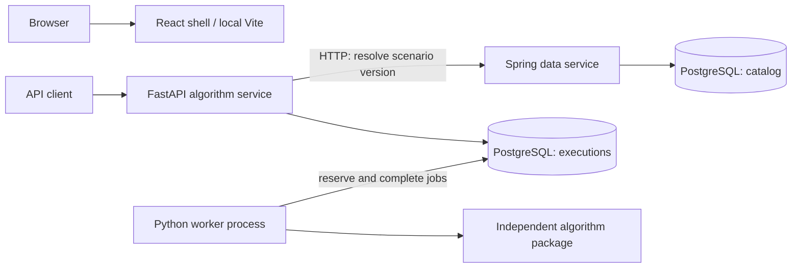

# Components, Runtime, and Verification

[Architecture overview](../architecture.md)

Status: November 1, 2026. Implemented behavior and planned extensions are distinguished explicitly.

## Component Boundaries

The browser-to-backend connections are not drawn as implemented paths: the current React application does not issue API requests. Both database schemas reside in one local PostgreSQL instance. The worker is started separately through `algorithm-worker`; Compose does not automatically launch it or the APIs.

### React frontend

Source: [apps/web](../../apps/web).

React and TypeScript define the interface; Vite provides local development and static production builds. MUI supplies the theme, baseline styles, and components. `BrowserRouter` and `QueryClientProvider` are configured, while showcase routes, server queries, mutations, and polling remain to be added.

React Hook Form, Zod, `openapi-fetch`, and `openapi-typescript` are installed for future form validation and typed API access. Backend client generation is not wired into the build yet. The current Vite configuration has no API proxy.

### Spring data service

Source: [catalog package](../../apps/data-service/src/main/kotlin/de/eseidinger/algorithmlab/dataservice/catalog).

Spring owns the showcase catalog and scenario versions. `CatalogController` handles HTTP and delegates read queries to `CatalogRepository`. The repository uses explicit SQL through `JdbcClient` and maps PostgreSQL JSONB input to a Jackson `JsonNode`, preserving an object in the HTTP response.

There is no separate application-service layer for these straightforward reads. It can be introduced when domain operations require orchestration or transactions spanning multiple repository calls.

Spring does not calculate Fibonacci and does not read or write Python execution tables.

### Python algorithm service

Source: [algorithm_service](../../apps/algorithm-service/src/algorithm_service).

| Module | Responsibility |
| --- | --- |
| `main.py` | Compose resources and services using FastAPI lifespan |
| `api.py` | POST/GET routes, dependency lookup, HTTP status and error translation |
| `schemas.py` | Public request/response models, Spring response model, and Fibonacci input validation |
| `data_client.py` | Synchronous HTTPX calls to Spring and upstream response validation |
| `executions.py` | Resolve and validate scenarios, choose the algorithm/version, and coordinate persistence |
| `models.py` | Internal typed execution record and allowed statuses |
| `repository.py` | SQLAlchemy SQL for creation, lookup, job reservation, and guarded completion/failure |
| `worker.py` | Process individual reservations and run the interruptible polling/retry loop |
| `worker_cli.py` | Configure logging, create/dispose the engine, and install/restore SIGINT/SIGTERM handlers |
| `config.py` | Environment-based settings and the psycopg database URL |

FastAPI routes are synchronous because the HTTPX and SQLAlchemy operations are synchronous. The asynchronous lifespan manages startup and shutdown; it does not make database operations asynchronous.

### Independent algorithm package

Source: [packages/algorithms](../../packages/algorithms).

`algorithm_lab.fibonacci.fibonacci` implements the numerical calculation without HTTP or persistence dependencies. The service depends on this package through the uv workspace. The single-job worker function invokes the algorithm; creating or reading an execution does not currently invoke it.

The algorithm uses `F(0) = 0`, `F(1) = 1` and rejects negative inputs. The HTTP-facing workflow additionally restricts input to strict integers from 0 through 78, keeping results within JavaScript's safe integer range.

## Runtime and Deployment

### Implemented local topology

- Vite serves the frontend, normally on port 5173.
- Spring runs on port 8080 by default.
- Uvicorn serves FastAPI on port 8000 when started with the documented command.
- `algorithm-worker` runs as a separate Python process with no HTTP port. It shares the execution database but not process-local API resources.
- Docker Compose currently starts PostgreSQL only, bound to localhost port 5432 with persistent storage.

Spring reads environment-based JDBC configuration and runs Flyway during application startup. Python uses Pydantic Settings and `postgresql+psycopg`. FastAPI lifespan creates one engine and HTTPX client per process and closes them at shutdown. HTTPX uses a five-second timeout with redirects disabled. The worker creates its own engine and does not need an HTTP client. It polls after idle results, delays retries after SQLAlchemy errors, and responds to SIGINT/SIGTERM cooperatively through a stop event. Waits are interruptible; an in-progress job is allowed to finish before exit. Engine disposal and handler restoration use an ExitStack, including on unexpected failure. Engine creation is lazy with respect to database connections; FastAPI startup does not prove database readiness or apply Alembic migrations.

### Planned hosted topology

The first slice targets four application components: a web server serving the React build and routing `/api/data` and `/api/algorithms`, a private Spring service, a private FastAPI service, and a separate Python worker process. API and worker can share a Python image but use different entrypoints.

Application Dockerfiles, reverse-proxy configuration, and a Developer Platform application declaration are not implemented. Authentication and deployment access-policy integration are also pending; the local APIs currently contain no application authentication layer.

The frontend currently has neither proxy routing nor cross-origin backend calls. Same-origin routing through the planned web server will provide a shared browser entrypoint.

## Verification Strategy

| Layer | Tools and current coverage |
| --- | --- |
| Algorithm | pytest and Hypothesis: known Fibonacci values, negative input, recurrence |
| Python validation and orchestration | pytest: configuration, schemas, scenario lookup errors, input rejection, service coordination, worker dispatch, calculation-versus-persistence error handling, loop retry/stop behavior, and CLI cleanup |
| Python HTTP | FastAPI TestClient: response shape, status codes, Location, request validation, and lifecycle cleanup |
| PostgreSQL | Testcontainers: migrations, JSONB persistence, rollback, API recreation, expired leases, row locks, concurrent reservations, guarded completion, and lease checks after row-lock waits, and actual worker subprocesses |
| Spring | JUnit, MockMvc, Testcontainers: migrations, immutable scenarios, catalog/scenario responses and error cases |
| Frontend | Vitest, React Testing Library, jsdom: accessible application shell |
| Static checks | Ruff and mypy; ktlint; ESLint and TypeScript; Prettier for the frontend |

Python API integration tests use real temporary PostgreSQL with simulated Spring HTTP responses. Spring tests use their own PostgreSQL container. These checks do not constitute a deployed end-to-end test of both real backends and the browser. The final slice still needs that acceptance journey.

See [HTTP scenarios](request-scenarios.md) for request flows and [reservation and worker scenarios](worker-scenarios.md) for concurrency and recovery.
