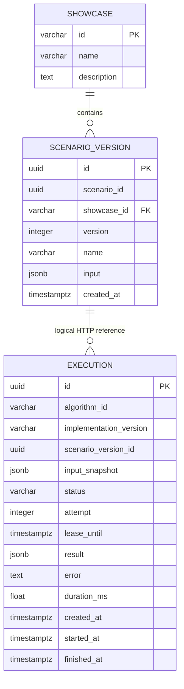

# Data Ownership, Executions, and Migrations

[Architecture overview](../architecture.md)

Status: November 1, 2026. Implemented behavior and planned extensions are distinguished explicitly.

## Data Ownership and Schema

One local database, `algorithm_lab`, has two application-owned schemas:

| Owner | Schema and tables | Role | Migration tool |
| --- | --- | --- | --- |
| Spring | `catalog.showcase`, `catalog.scenario_version` | `catalog_app` | Flyway |
| Python | `executions.execution` | `execution_app` | Alembic |

The [initialization script](../../infra/postgres/001-init.sql) creates the roles and schemas. Separate schemas, ownership, and credentials express the service boundary; the shared PostgreSQL instance remains a shared operational dependency. Applications access the other service's domain through HTTP, not cross-schema queries.

The relationship from execution to scenario version is logical: there is no database foreign key across service boundaries. The service validates the referenced version through Spring before inserting the job.

### Scenario identity and immutability

`scenario_id` identifies a scenario across versions; `id` identifies one immutable version. The pair `(scenario_id, version)` is unique. A PostgreSQL trigger rejects row updates and deletes of scenario versions. Changed inputs require a new row with a new version identity.

The initial fixture is showcase `K01`, scenario version `00000000-0000-4000-8000-000000000010`, with input `{"n": 10}`.

### Execution identity and reproducibility

An execution has its own UUID and records the scenario-version reference, validated input snapshot, algorithm identifier, and implementation version. The service currently chooses `fibonacci.iterative` and version `1`; the client cannot override these or supply different inputs.

The input snapshot allows execution reads and future computation without another Spring lookup. Algorithm behavior changes require maintaining a meaningful implementation version; the current version is an explicit code constant, not an automatically generated artifact digest.

## Reservation and Future Worker Semantics

Implemented reservation behavior in `ExecutionRepository.reserve_execution()`:

1. Select a queued job or a running job with an expired, non-null lease.
2. Order candidates by creation time and UUID.
3. Lock at most one candidate with `FOR UPDATE SKIP LOCKED`.
4. Atomically set `running`, increment `attempt`, and assign a database-clock lease deadline.
5. Set `started_at` for the current attempt and clear old result, error, duration, and finish fields.
6. Commit before returning the reserved execution.

The default lease is 30 seconds; nonpositive durations are rejected. No eligible candidate returns `None`. Locked candidates are skipped, active leases are excluded, and terminal jobs are never selected.

```mermaid
stateDiagram-v2
    [*] --> queued: API creation
    queued --> running: reserve; increment attempt
    running --> running: expired lease; reserve a new attempt
    running --> succeeded: planned guarded completion
    running --> failed: planned guarded failure
```

`succeeded`, `failed`, and `cancelled` are already permitted by the schema, but completion/failure methods, a cancellation workflow, lease renewal, and a worker loop are not implemented. Reservation is currently callable code rather than an active background process.

The future worker must compute outside the reservation transaction and condition completion on the execution ID, current attempt, running state, and valid lease. A lease expiry cannot physically stop an old process from computing. Attempt checks will prevent an obsolete attempt from overwriting a newer result; they are not an exactly-once computation guarantee.

## Migration Boundaries

- The PostgreSQL initialization script provisions roles and schemas on an empty local volume.
- Flyway owns `catalog` and stores history in `catalog.flyway_schema_history`.
- Alembic owns `executions` and stores history in `executions.alembic_version`.
- Python metadata autogeneration is not configured; migrations are written manually.
- Existing retained/shared database migrations are preserved; changes get new revisions.

Deployment sequencing for Alembic has not been implemented. Database changes should remain compatible with application versions that may overlap during rollout. Replacing application code does not automatically reverse a migration. Destructive local reset instructions are documented separately in [Local Development](../development.md).

See [reservation and worker scenarios](worker-scenarios.md) for detailed lease and recovery sequences.
