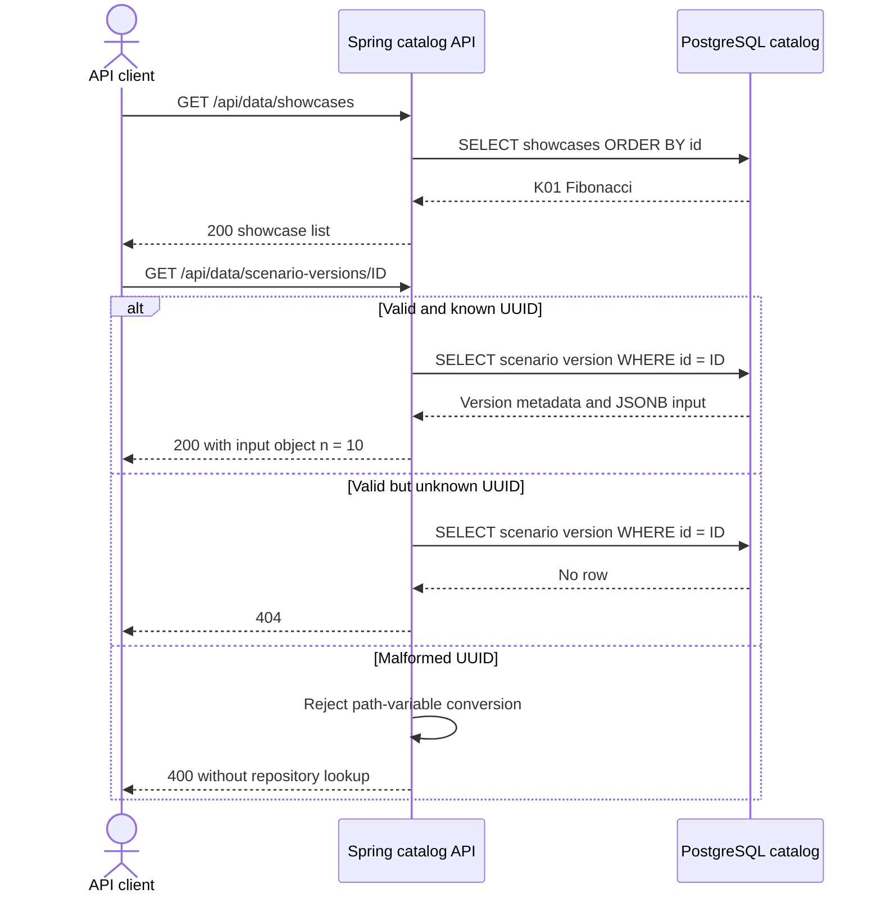
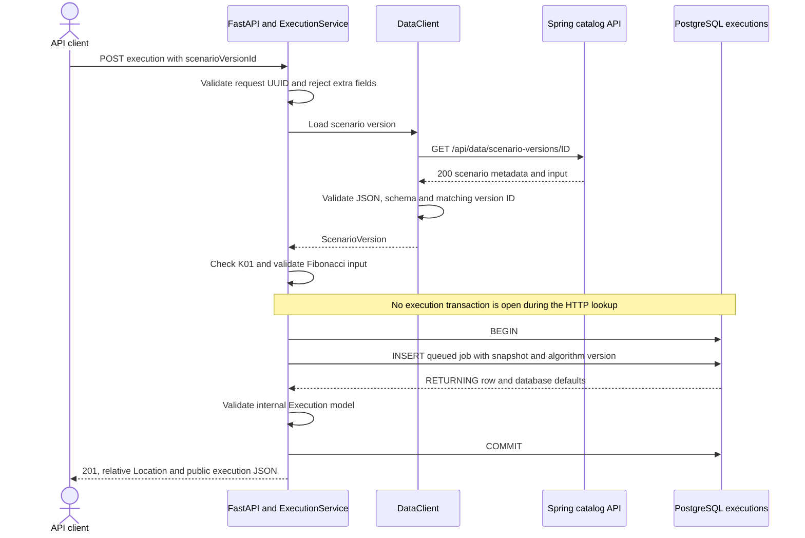
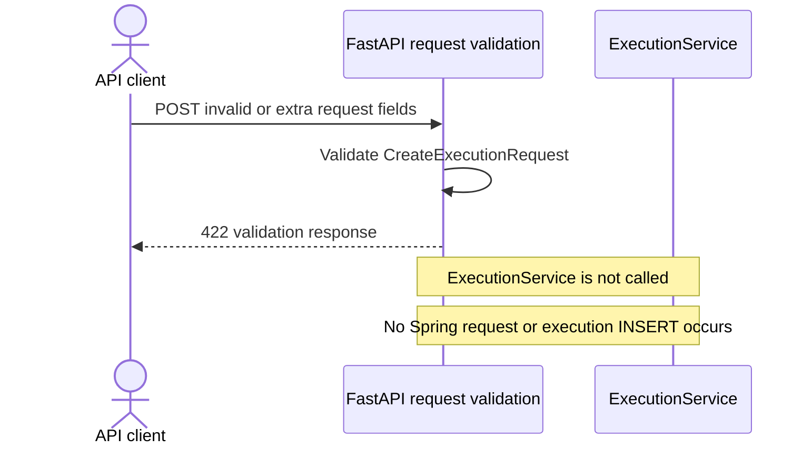
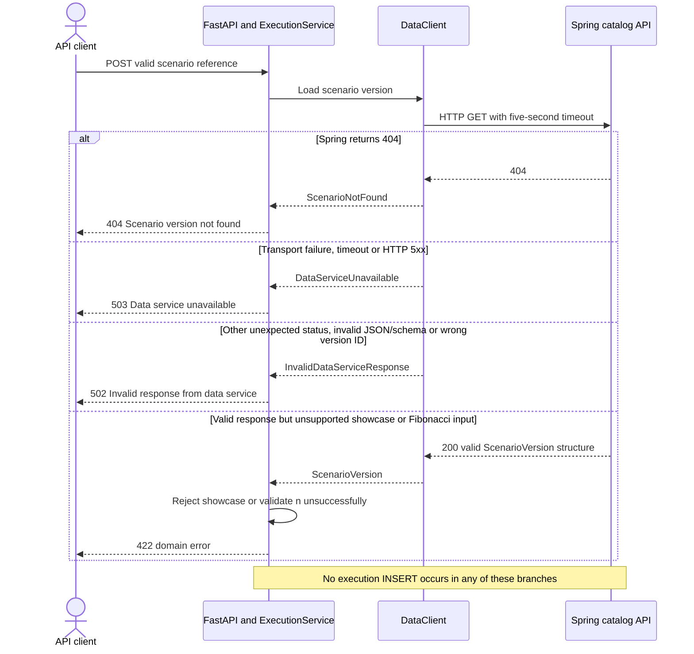
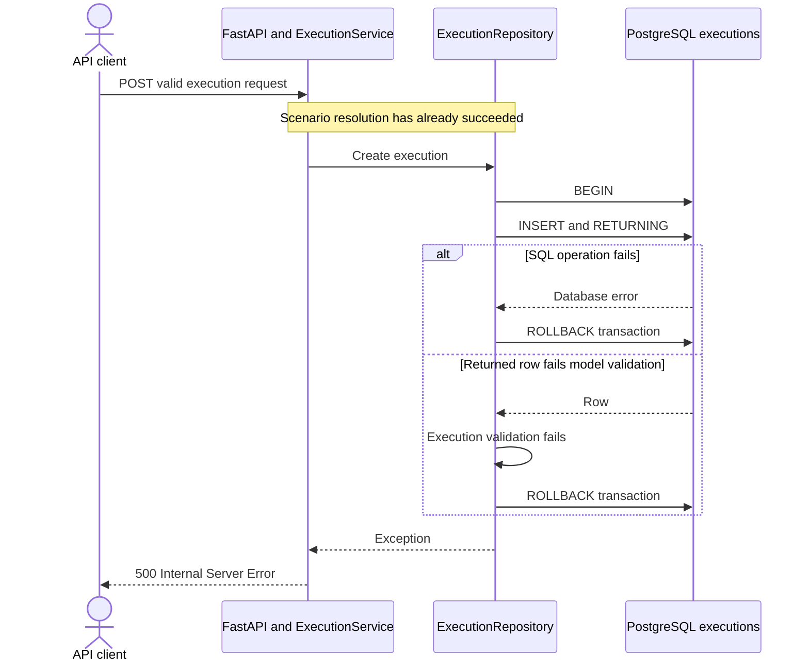
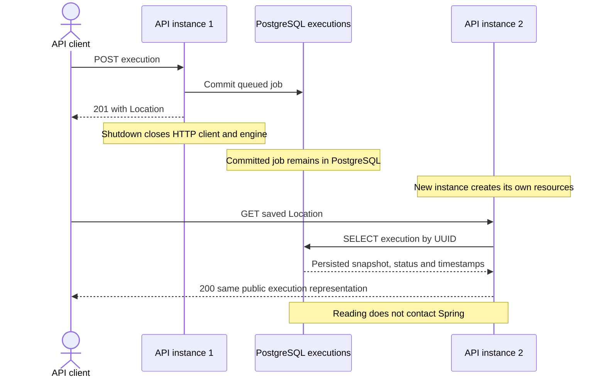
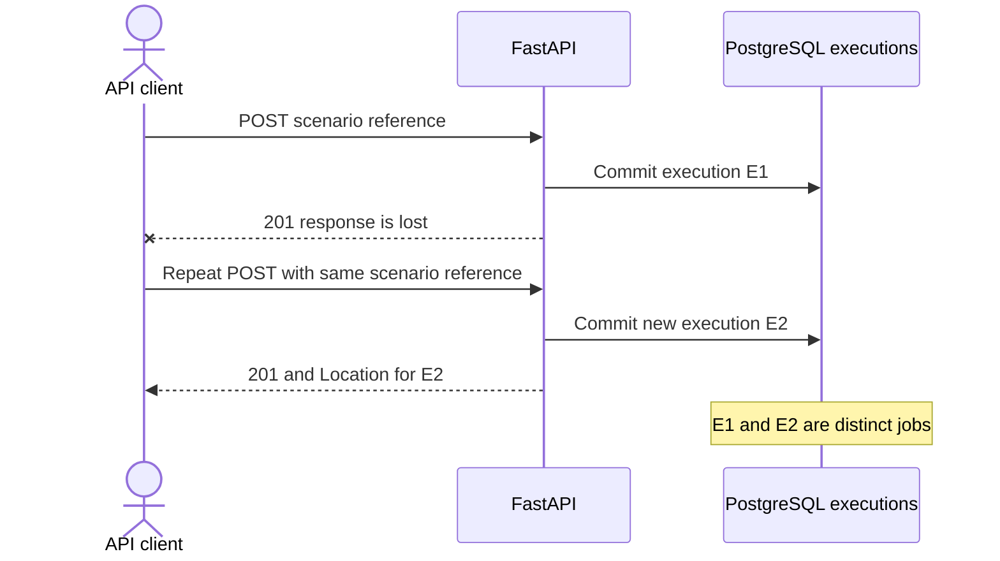

# HTTP Request Scenarios

[Architecture overview](../architecture.md) · [HTTP contracts](http-api.md) · [Components](components-and-runtime.md)

Status: November 1, 2026. These scenarios describe implemented backend behavior. The initiating actor is an API client: the React application is not yet connected. Catalog and execution stores in the diagrams are separate schemas in the same PostgreSQL instance.

## R1. Browse the Catalog and Load a Scenario

**Prerequisites:** Spring is running and Flyway has applied the catalog migrations. The caller knows the seeded scenario-version ID; listing scenario versions for a showcase is not implemented.

**Trigger:** The client requests the catalog, then a specific scenario version.

**Outcome:** Known versions are returned with immutable identity and structured input, not a JSON-encoded string. Spring maps unknown IDs to 404 and malformed IDs to 400. FastAPI uses 422 for malformed UUIDs in its own routes; the two services do not currently have an identical validation-error convention.

**Evidence:** [Spring HTTP and migration tests](../../apps/data-service/src/test/kotlin/de/eseidinger/algorithmlab/dataservice/DataServiceApplicationTests.kt).

## R2. Create an Execution Successfully

**Prerequisites:** Spring can resolve the scenario version, PostgreSQL roles/schemas exist, and Alembic has created the execution table. The scenario belongs to K01 and contains a strict integer n between 0 and 78.

**Trigger:** POST a `scenarioVersionId` to `/api/algorithms/executions`.

**Outcome:** The committed job has a new UUID, status `queued`, attempt 0, input snapshot, scenario reference, `fibonacci.iterative`, and implementation version `1`. The response is produced after commit. It exposes public camelCase fields and omits internal lease, attempt, and error fields. No algorithm is invoked yet.

**Evidence:** [API integration tests](../../apps/algorithm-service/tests/test_api_integration.py), [repository tests](../../apps/algorithm-service/tests/test_repository.py), and [execution service tests](../../apps/algorithm-service/tests/test_executions.py). Python integration tests simulate Spring's HTTP response while using real temporary PostgreSQL; they do not run the real Spring service.

## R3. Reject an Invalid Client Request

**Prerequisites:** FastAPI is running.

**Trigger:** POST a missing/invalid scenario UUID, or try to supply additional fields such as `input`.

**Outcome:** No job is created. The client cannot overwrite a scenario's inputs through POST. Python-style field names are also accepted by the current alias configuration; they are not rejected merely for differing from the documented camelCase spelling.

**Evidence:** [API tests](../../apps/algorithm-service/tests/test_api.py) and [schema tests](../../apps/algorithm-service/tests/test_schemas.py).

## R4. Fail Scenario Resolution or Domain Validation

**Prerequisites:** The POST request itself is valid. Execution persistence has not started.

**Trigger:** Spring cannot resolve a usable scenario, or the resolved inputs are unsupported.

The distinction between 502 and 422 is deliberate: a malformed Spring response violates the upstream contract; a structurally valid scenario can still be unsuitable for this algorithm. Examples of the latter are K02, n = 79, and boolean n. The client does not follow redirects; a 3xx response is unexpected.

**Outcome:** The execution table remains unchanged. Upstream/internal details are not included in the public 404/502/503 messages.

**Evidence:** [DataClient tests](../../apps/algorithm-service/tests/test_data_client.py), [service tests](../../apps/algorithm-service/tests/test_executions.py), [API tests](../../apps/algorithm-service/tests/test_api.py), and [API integration failure cases](../../apps/algorithm-service/tests/test_api_integration.py).

## R5. Fail While Persisting the Execution

**Prerequisites:** Scenario resolution and input validation succeeded.

**Trigger:** An insert or internal row validation fails before commit, for example a database constraint rejects a value.

**Outcome:** A failure before commit leaves no inserted job. The repository does not return success, and the API emits no success `Location`. With the current non-debug configuration, unexpected exception text is not exposed.

This rollback guarantee is specifically for failure before commit. A connection failure during commit can leave the client uncertain about whether the transaction committed; no distributed acknowledgment protocol resolves that uncertainty here.

**Evidence:** [Failed insert and repository recovery test](../../apps/algorithm-service/tests/test_repository.py) and [unexpected API error test](../../apps/algorithm-service/tests/test_api.py). The invalid-returned-model branch follows the transaction structure but does not currently have a dedicated fault-injection test.

## R6. Read a Job After an API Restart

**Prerequisites:** A POST has committed a job, and its ID or Location is retained by the caller.

**Trigger:** Shut down the API, start another instance against the same execution database, and GET the saved Location.

**Outcome:** No process-local cache is needed for execution durability. GET for an unknown UUID returns 404; a malformed UUID is rejected with 422. Queued jobs have null results until `process_next_execution()` is invoked successfully or a future worker loop processes them.

**Evidence:** [API integration restart scenario](../../apps/algorithm-service/tests/test_api_integration.py) recreates the API, engine, and clients against the same temporary database. It models resource recreation rather than killing an operating-system process.

## R7. Retry After Losing a Successful POST Response

**Prerequisites:** The first POST committed, but the caller did not receive its response.

**Trigger:** The caller repeats the same POST.

**Outcome:** Both jobs may exist. Scenario identity does not deduplicate execution requests. This is current semantics derived from UUID generation and unconditional insertion, not an idempotent retry guarantee. There is no dedicated response-loss test or idempotency-key implementation.
