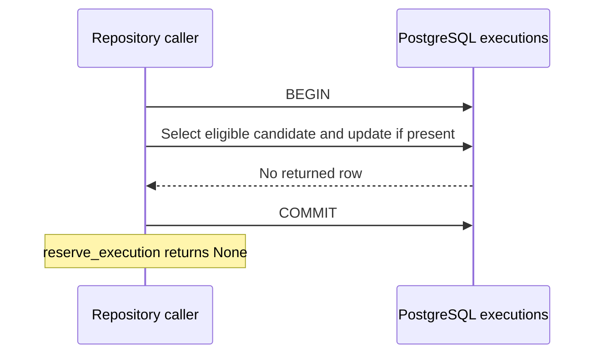
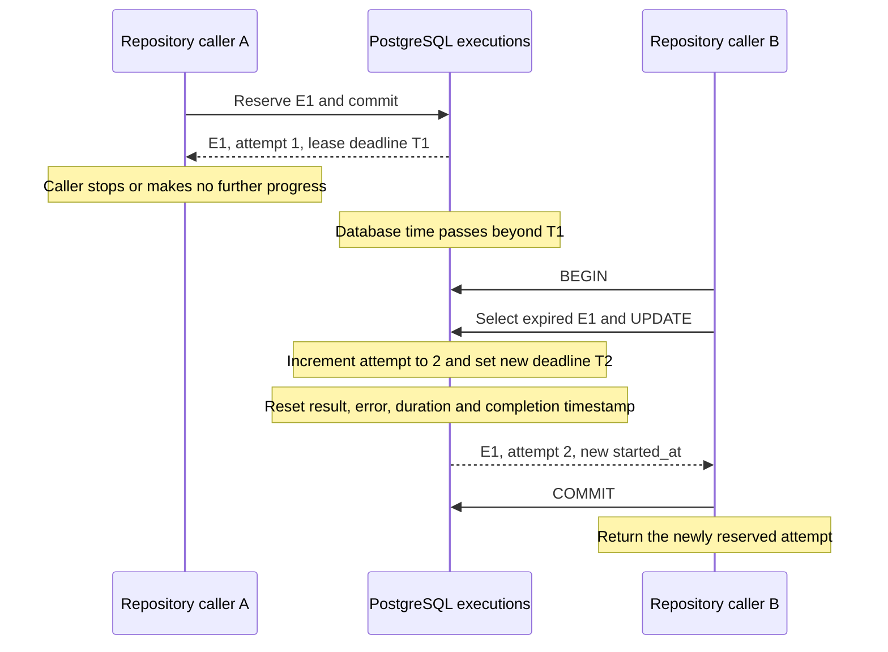
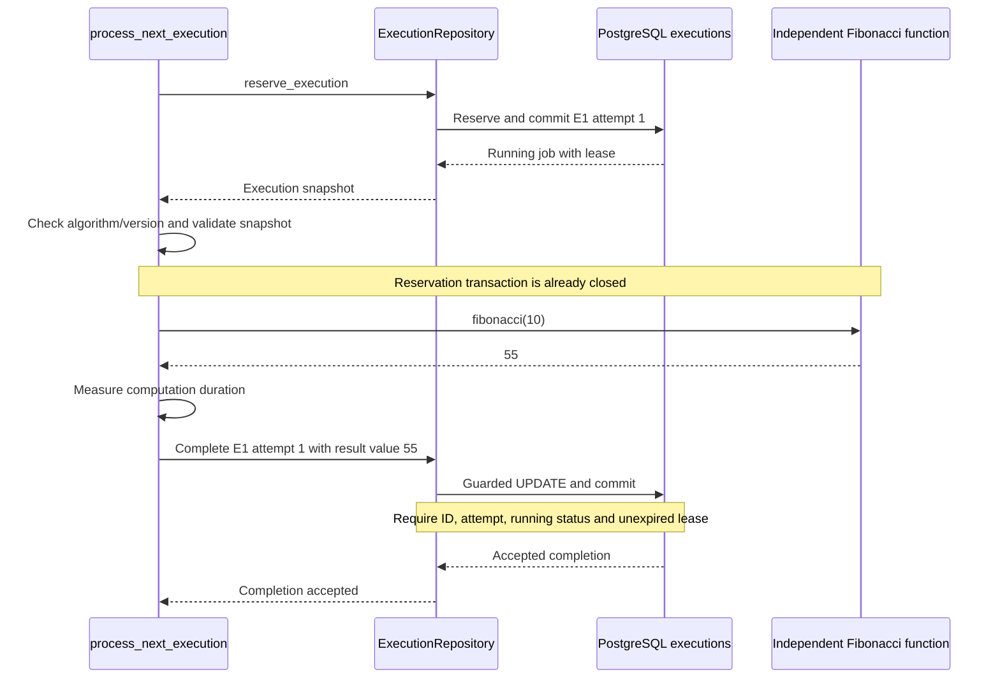
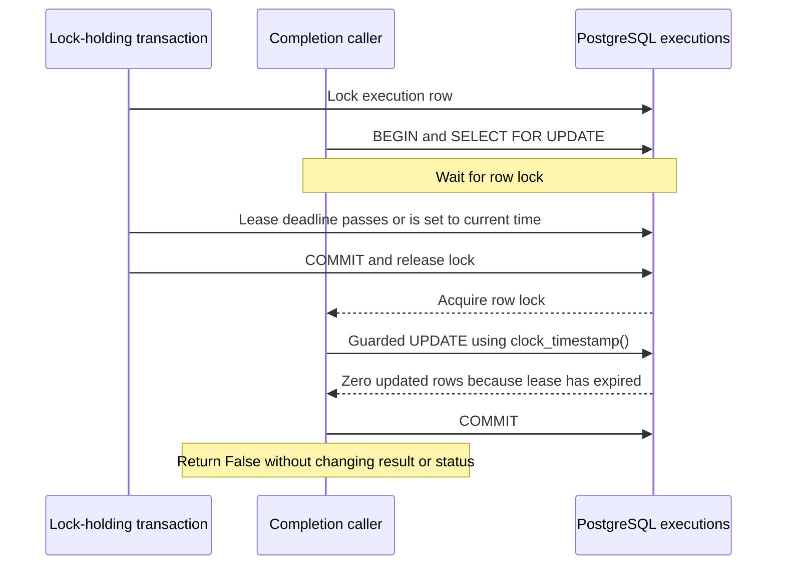
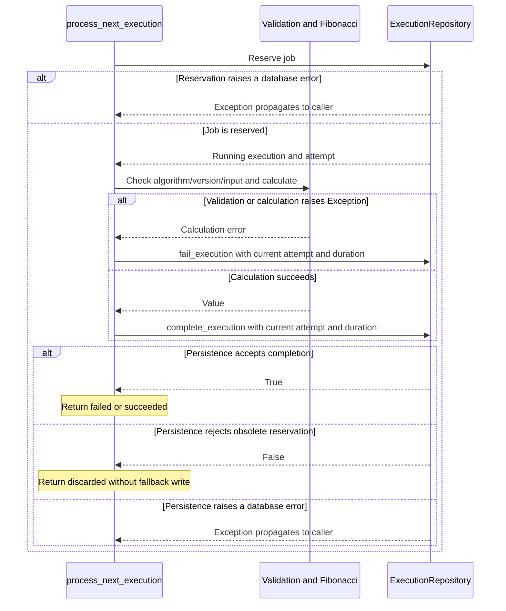
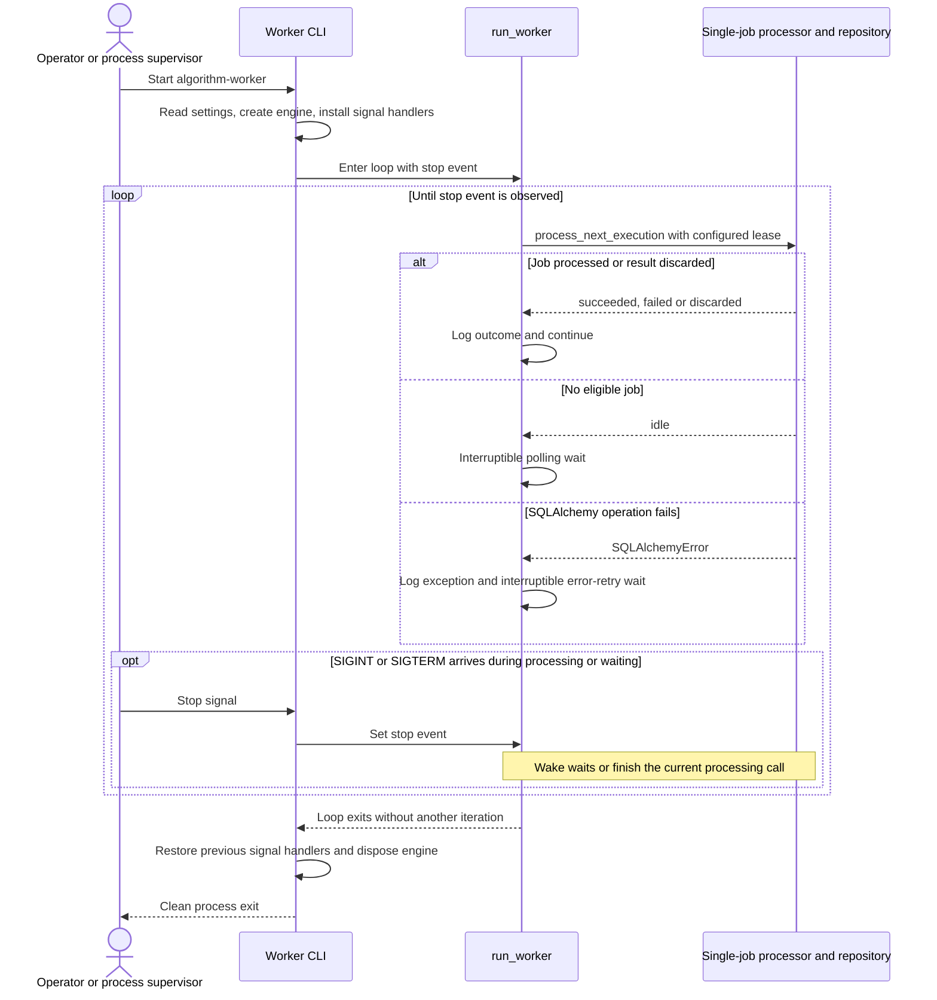

# Reservation and Worker Scenarios

[Architecture overview](../architecture.md) · [Data and executions](data-and-executions.md) · [HTTP scenarios](request-scenarios.md)

Status: November 1, 2026. **Reservation, lease recovery, guarded completion/failure, and single-job worker processing are implemented.** The worker loop and CLI are also implemented; heartbeat renewal and the cancellation workflow are not. Diagrams W1–W3 and W5–W6 show repository callers; W4 and W7 show explicitly invoked worker processing. W8 describes the implemented process lifecycle. A worker process runs only when its CLI is started; it is not launched automatically by Compose.

## W1. Competing Callers Reserve Different Jobs

**Implemented.** Prerequisites: two queued jobs E1 and E2, with E1 ordered first. Separate callers use independent PostgreSQL connections.

**Trigger:** Both call `reserve_execution()` while the first transaction still owns a row lock.

```mermaid
sequenceDiagram
    participant A as Repository caller A
    participant B as Repository caller B
    participant D as PostgreSQL executions
    A->>D: BEGIN
    A->>D: CTE selection and UPDATE with SKIP LOCKED
    D-->>A: E1 running, attempt 1; row lock retained
    B->>D: BEGIN
    B->>D: CTE selection and UPDATE with SKIP LOCKED
    Note over B,D: E1 is locked, so select E2
    D-->>B: E2 running, attempt 1
    B->>D: COMMIT
    Note over B: Return E2 with active lease
    A->>D: COMMIT
    Note over A: Return E1 with active lease
```

**Outcome:** Each caller receives a different job. If only E1 exists, the competing caller returns `None` instead of receiving E1. After commit, row locks are released; persisted status and lease prevent another caller from immediately reserving the same job.

The selection and update are one SQL statement. Both occur in a short transaction, and no computation is performed inside it. The default lease is 30 seconds.

**Evidence:** [Reservation tests](../../apps/algorithm-service/tests/test_reservations.py) cover an explicitly locked candidate and two concurrent callers contending for one job.

## W2. No Eligible Work Is Available

**Implemented.** Prerequisites: the queue is empty, or all rows are locked, actively leased, or terminal.

**Trigger:** A caller attempts to reserve one job.



**Outcome:** No row is changed and no exception is required. The worker loop waits for the configured polling interval, using an interruptible stop event, before trying again.

Jobs in `succeeded`, `failed`, or `cancelled` are excluded. A running row with a null lease is also not an expired candidate. Nonpositive lease durations raise `ValueError` before a database transaction starts.

**Evidence:** [Empty queue, active lease, terminal-state and locked-row tests](../../apps/algorithm-service/tests/test_reservations.py).

## W3. Recover an Expired Reservation

**Implemented.** Prerequisites: E1 is running with attempt 1. Its first caller stops making progress and its lease expires.

**Trigger:** Another caller reserves work after the deadline.



**Outcome:** E1 becomes available again without an administrator manually requeuing it. `started_at` identifies the current attempt, not necessarily the first attempt. Input snapshot, algorithm identity, and scenario reference remain unchanged.

Reservation does not terminate the old caller. If it resumes, both processes could compute. Completion is guarded separately by ID, attempt, running state, and current lease validity; that persistence protection is implemented.

**Evidence:** [Lease expiry and retry-state test](../../apps/algorithm-service/tests/test_reservations.py) moves the deadline into the past explicitly, avoiding sleeps and wall-clock races.

## W4. Compute and Persist a Successful Result

**Implemented as one explicit call to `process_next_execution()`.** Prerequisites: an eligible job exists and a caller supplies an execution repository. The continuous loop and CLI repeatedly invoke this function when started.

**Trigger:** The worker receives a reservation for `fibonacci.iterative`, implementation version `1`, with input n = 10.



**Outcome:** Status becomes `succeeded`, with structured result `{"value":55}`, completion timestamp, and duration. A calculation failure similarly sets `failed` only for the current valid attempt. API reads can then expose the saved outcome.

The worker should use the stored input snapshot and should not fetch it again from Spring. Timing includes validation and calculation and excludes database operations. The function returns `idle`, `succeeded`, `failed`, or `discarded`; these outcomes are not extra persisted statuses. Lease renewal and checkpoints remain unimplemented; a result whose lease expired is discarded. No result transition is implied merely by having reserved the job.

**Evidence:** [Worker unit tests](../../apps/algorithm-service/tests/test_worker.py) cover dispatch, validation, error boundaries, and discarded completions. [Worker integration tests](../../apps/algorithm-service/tests/test_worker_integration.py) verify successful computation, stored failure, and lease-expiry discard followed by retry recovery against temporary PostgreSQL. [Worker process tests](../../apps/algorithm-service/tests/test_worker_process.py) cover the installed CLI against PostgreSQL and both shutdown signals. A browser journey is not tested yet.

## W5. Reject a Late Result from an Obsolete Attempt

**Implemented repository behavior.** Prerequisite: W3 has reassigned E1 to attempt 2. The callers below invoke completion methods directly; the worker loop uses the same guarded completion methods.

**Trigger:** The old worker resumes and tries to publish the result of attempt 1.

```mermaid
sequenceDiagram
    participant A as Old attempt caller
    participant B as New attempt caller
    participant D as PostgreSQL executions
    Note over A,D: A held attempt 1; its lease expired
    B->>D: Reserve E1 as attempt 2 and commit
    D-->>B: New reservation
    A->>D: Guarded completion WHERE attempt = 1
    D-->>A: Zero updated rows; reject stale result
    Note over D: Attempt 2 remains unchanged
    B->>D: Guarded completion WHERE attempt = 2 and lease valid
    D-->>B: One updated row; commit succeeded
```

**Expected outcome:** The old result cannot overwrite the new attempt. A completion whose lease has expired should also be rejected even if no replacement has reserved the job yet. Unknown, terminal, or otherwise mismatched jobs must not be updated.

The completion tests verify these guards, including rejection of both success and failure updates from obsolete attempts. It provides protection against stale writes, not exactly-once computation. Repeating an algorithm with external side effects would require additional idempotency design; the current pure Fibonacci function has no such effects.

## W6. Lease Expires While Completion Waits for a Row Lock

**Implemented repository behavior.** Prerequisites: a running attempt has a valid lease, and another database transaction holds its row lock.

**Trigger:** A caller starts completion but must wait for that lock.



**Outcome:** A lease that was valid when the completion transaction began is not automatically valid when the lock becomes available. Both completion methods acquire the lock before evaluating the time-sensitive update and use actual database wall-clock time rather than the fixed transaction-start timestamp.

**Evidence:** [Completion lock-wait tests](../../apps/algorithm-service/tests/test_completion.py) observe the blocked connection in `pg_stat_activity`, expire its lease while the lock is held, then verify rejection for success and failure. No timing sleep is used to simulate expiry; the observer polls with a bounded timeout.

## W7. Separate Calculation Failure from Persistence Failure

**Implemented single-job behavior.** Trigger: input validation or Fibonacci raises an exception, or a persistence call fails.



**Outcome:** Only exceptions within validation/computation become stored calculation failures. Errors during reservation, success persistence, or failure persistence propagate; they do not trigger another completion attempt. An interrupted process can leave a running job to be recovered after lease expiry. `KeyboardInterrupt` is not caught as a calculation failure. Error text is stored internally and is not part of the public execution response.

**Evidence:** [Worker unit tests](../../apps/algorithm-service/tests/test_worker.py) exercise empty queues, validation and calculation errors, both discarded outcomes, each persistence error boundary, and interruption.

## W8. Poll, Retry, and Shut Down the Worker Process

**Implemented.** Prerequisites: execution migrations are applied and `algorithm-worker` is started with valid database credentials and positive timing settings.



The signal may arrive during any operation in a loop iteration; the optional signal block illustrates its effect rather than restricting its timing. Shutdown is cooperative and does not forcibly interrupt an algorithm or blocked database call. The default idle delay is one second, the database-error delay is five seconds, and the lease is 30 seconds. Unexpected non-SQLAlchemy loop errors propagate after cleanup rather than entering an unconditional retry loop.

Jobs created while the worker is stopped remain queued. On startup the CLI drains them; jobs submitted afterward are picked up by the same process. The worker uses stored snapshots and does not call Spring.

**Evidence:** [Loop tests](../../apps/algorithm-service/tests/test_worker_loop.py) exercise stop-before-start, processing multiple outcomes, database-error recovery, interruptible idle/error waits, and stop-after-current-job. [CLI tests](../../apps/algorithm-service/tests/test_worker_cli.py) verify signal handling and cleanup on normal return, loop exceptions, and partial signal setup failure. [Process tests](../../apps/algorithm-service/tests/test_worker_process.py) execute the installed command against temporary PostgreSQL, process jobs submitted before and after startup, and exit cleanly on SIGINT/SIGTERM.

## Planned Browser Acceptance Scenario

Once the frontend is connected to the implemented backends and worker, the acceptance journey is: select a scenario, POST an execution, poll its saved URL until `succeeded`, display 55, then reload the URL and obtain the same stored result. Also submit while the worker is stopped and verify that starting it later processes the durable job. These are acceptance scenarios from the [first slice plan](../Algorithm_Lab_First_Vertical_Slice_Plan.md), not currently available browser behavior.
